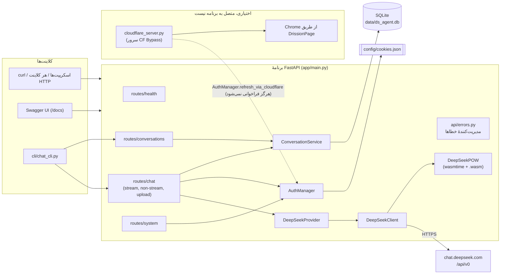
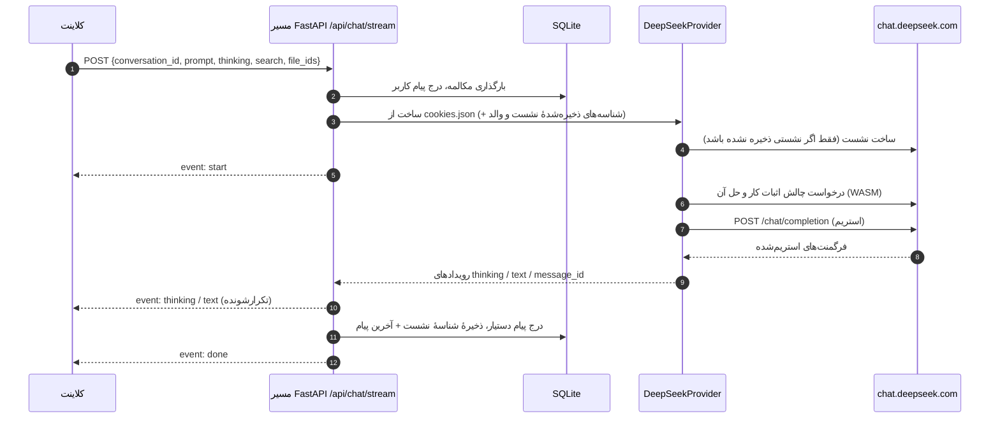
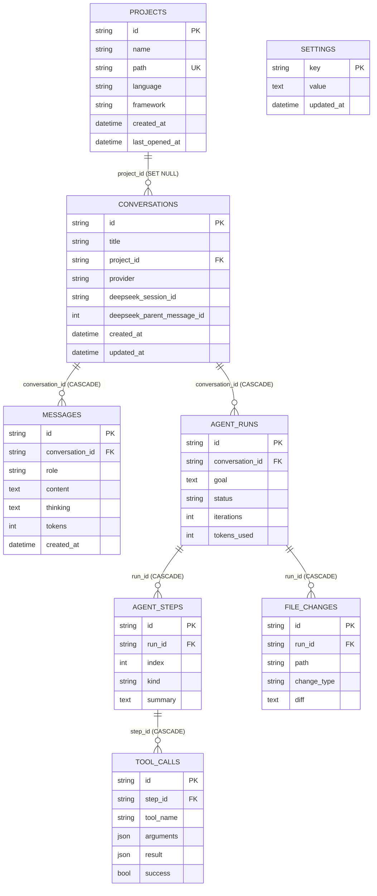

<div dir="rtl" align="right">

<div align="center">

# DS Agent Studio

**یک بک‌اند محلی مبتنی بر FastAPI که نشست چت وب DeepSeek شما را به‌صورت API از نوع REST و Server-Sent-Events در اختیار می‌گذارد و مکالمه‌ها را به‌صورت پایدار در SQLite ذخیره می‌کند.**

[English](README.md) | فارسی

</div>

> **وضعیت:** پروژه در مرحلهٔ اولیه و در حال توسعه است (متادیتای FastAPI نسخهٔ `0.3.0` را گزارش می‌کند). فعلاً رابط وب، احراز هویت API و حلقهٔ خودکار عامل (agent) وجود ندارد. پیش از استفاده برای هر کاری فراتر از آزمایش‌های محلی، بخش [محدودیت‌ها](#limitations) را بخوانید.

---

<a id="toc"></a>
## فهرست مطالب

1. [معرفی](#introduction)
2. [قابلیت‌ها](#features)
3. [معماری](#architecture)
4. [ساختار پروژه](#structure)
5. [پشتهٔ فناوری](#stack)
6. [نیازمندی‌ها و نصب](#installation)
7. [پیکربندی](#configuration)
8. [اجرای برنامه](#running)
9. [مرجع API](#api)
10. [گردش کار مکالمه](#conversation-workflow)
11. [فایل‌ها و پیوست‌ها](#files)
12. [یکپارچه‌سازی با DeepSeek](#deepseek)
13. [احراز هویت، کوکی‌ها و ابزار کمکی Cloudflare](#auth)
14. [پایگاه داده](#database)
15. [مدیریت خطا و لاگ‌گیری](#errors)
16. [امنیت](#security)
17. [آزمون‌ها](#testing)
18. [عیب‌یابی](#troubleshooting)
19. [محدودیت‌ها و نقشهٔ راه](#limitations)
20. [مجوز و مشارکت](#license)

---

<a id="introduction"></a>
## ۱. معرفی

### این پروژه چیست؟

DS Agent Studio یک سرویس پایتونی (FastAPI + SQLAlchemy + SQLite) است که میان ابزارهای خودِ شما و **چت وب DeepSeek** (`https://chat.deepseek.com`) قرار می‌گیرد. این سرویس از API رسمی و پولی DeepSeek استفاده نمی‌کند؛ در عوض با همان نقاط انتهایی خصوصی HTTP که وب‌سایت DeepSeek استفاده می‌کند صحبت می‌کند و با یک توکن نشست و کوکی‌هایی که **خودتان** فراهم می‌کنید احراز هویت می‌شود.

### چه مشکلی را حل می‌کند؟

این نقاط انتهایی مستند نیستند، برای هر تکمیل پاسخ (completion) به حل یک چالش اثبات کار (proof-of-work) نیاز دارند، قالب استریم اختصاصی دارند و زمینهٔ مکالمه را با شناسهٔ نشست و شناسهٔ پیام والد در سمت سرور نگه می‌دارند. DS Agent Studio این پیچیدگی را پشت یک API محلی کوچک و مستند پنهان می‌کند:

- چالش اثبات کار را (با یک ماژول WebAssembly همراه پروژه) حل می‌کند؛
- برای هر مکالمهٔ محلی یک نشست چت DeepSeek می‌سازد و آن را به خاطر می‌سپارد؛
- پیام‌ها را با شناسهٔ صحیح پیام والد به هم زنجیر می‌کند تا زمینه میان نوبت‌ها حفظ شود؛
- قالب استریم DeepSeek را به رویدادهای تمیز `thinking` و `text` تبدیل می‌کند؛
- مکالمه‌ها و پیام‌ها (به‌همراه متن استدلال) را در یک پایگاه داده SQLite محلی ذخیره می‌کند؛
- فایل‌ها را به DeepSeek آپلود می‌کند و شناسه‌هایی برمی‌گرداند که می‌توانید به پرامپت پیوست کنید.

### قابلیت‌های اصلی

- چند مکالمهٔ مستقل که هر کدام به نشست چت DeepSeek مخصوص خود وصل است.
- نقاط انتهایی چت استریم (`text/event-stream`) و غیر استریم.
- پرچم‌های اختیاری استدلال («thinking») و جست‌وجوی وب که به DeepSeek ارسال می‌شوند.
- آپلود فایل (تا ۲۰ مبی‌بایت) با انتظار تا پایان پردازش.
- نقاط انتهایی CRUD مکالمه و تاریخچهٔ پیام.
- یک کلاینت چت خط فرمان حداقلی.
- یک ابزار کمکی مستقل و اختیاری برای عبور از چالش Cloudflare و دریافت کوکی مرورگر.

### مخاطبان

توسعه‌دهندگانی که یک رابط HTTP محلی و قابل اسکریپت‌نویسی به حساب وب DeepSeek خودشان می‌خواهند؛ برای آزمایش، ابزارهای شخصی یا نقطهٔ شروع یک عامل (agent) بزرگ‌تر. این نرم‌افزار تک‌کاربره است: حساب کاربری، کلید API یا جداسازی چندمستاجری ندارد.

### هشدار مهم

این سرویس به نقاط انتهایی مستندنشده و به توکنی که از یک نشست واردشدهٔ مرورگر گرفته می‌شود وابسته است. این نقاط ممکن است بدون اطلاع قبلی تغییر کنند یا از کار بیفتند و مسئولیت استفادهٔ مطابق شرایط خدمات DeepSeek با خود شماست.

### وضعیت فعلی پروژه

| بخش | وضعیت |
|---|---|
| REST API (مکالمه‌ها، چت، آپلود، سیستم) | پیاده‌سازی شده |
| چت استریم SSE | پیاده‌سازی شده |
| ذخیره‌سازی SQLite | پیاده‌سازی شده |
| رابط وب | **وجود ندارد** (فقط Swagger UI خودکار در `/docs`) |
| احراز هویت API | **وجود ندارد** |
| زمان‌اجرای عامل (tool call، اجرا، تغییر فایل) | **پیاده‌سازی نشده** — فقط جدول‌های پایگاه داده و تنظیمات بلااستفاده وجود دارند |
| تازه‌سازی خودکار کوکی | کد کمکی وجود دارد اما **به برنامه متصل نیست** |

---

<a id="features"></a>
## ۲. قابلیت‌ها

همهٔ موارد زیر در کد فعلی پیاده‌سازی شده‌اند. مواردی که فقط به‌دلیل نام فایل، جدول یا تنظیمات پیاده‌سازی‌شده به نظر می‌رسند در [محدودیت‌ها](#limitations) آمده‌اند.

### ۲٫۱ یکپارچه‌سازی با DeepSeek
کلاس `DeepSeekProvider` (روی `DeepSeekClient`) نشست چت می‌سازد، چالش‌های اثبات کار را دریافت و حل می‌کند، پرامپت را می‌فرستد و پاسخ استریم‌شده را تجزیه می‌کند. [بخش ۱۲](#deepseek) را ببینید.

### ۲٫۲ مدیریت مکالمه
ایجاد، فهرست (صفحه‌بندی‌شده)، دریافت، تغییر نام و حذف مکالمه و خواندن تاریخچهٔ ذخیره‌شدهٔ پیام‌ها. مکالمه‌ای که عنوان سفارشی ندارد به‌صورت خودکار از خط اول نخستین پرامپتش (۸۰ نویسهٔ اول) نام‌گذاری می‌شود.

### ۲٫۳ زمینه‌های مستقل مکالمه
هر مکالمهٔ محلی `chat_session_id` مخصوص خود در DeepSeek و شناسهٔ آخرین پیام دستیار (`parent_message_id`) را ذخیره می‌کند. هیچ دو مکالمه‌ای نشست DeepSeek مشترک ندارند، بنابراین زمینه‌هایشان مستقل است. زمینه **در سمت DeepSeek** نگهداری می‌شود؛ جدول پیام‌های محلی دوباره داخل پرامپت‌ها ارسال نمی‌شود.

### ۲٫۴ تاریخچهٔ پایدار
مکالمه‌ها و پیام‌ها (کاربر و دستیار، به‌همراه متن استدلال پیام‌های دستیار) در `data/ds_agent.db` ذخیره می‌شوند و پس از راه‌اندازی مجدد باقی می‌مانند.

### ۲٫۵ پاسخ استریم
`POST /api/chat/stream` رویدادهای Server-Sent Events برمی‌گرداند: `start`، `thinking`، `text`، `error`، `done`. نسخهٔ غیر استریم، یعنی `POST /api/chat`، کل پاسخ را جمع می‌کند و JSON برمی‌گرداند.

### ۲٫۶ خروجی تفکر / استدلال
وقتی درخواست `"thinking": true` داشته باشد، از DeepSeek خواسته می‌شود ابتدا استدلال کند. تکه‌های استدلال به‌صورت رویداد `thinking` ارسال و در `messages.thinking` ذخیره می‌شوند؛ پاسخ نهایی به‌صورت رویداد `text` ارسال و در `messages.content` ذخیره می‌شود.

### ۲٫۷ حالت جست‌وجو
وقتی درخواست `"search": true` داشته باشد، پرچم جست‌وجو به DeepSeek ارسال می‌شود. برنامه نتایج یا منابع جست‌وجو را در اختیار کلاینت نمی‌گذارد؛ فقط نشانگرهای ارجاع درون‌متنی به شکل `[citation: N]` را از متن حذف می‌کند. [۱۲٫۵](#deepseek-search) را ببینید.

### ۲٫۸ آپلود فایل و پیوست
`POST /api/chat/upload` فایلی (حداکثر ۲۰ مبی‌بایت) را به DeepSeek آپلود می‌کند، صبر می‌کند تا DeepSeek پردازش آن را گزارش دهد و یک `file_id` برمی‌گرداند. هنگام چت، یک یا چند شناسه را در `file_ids` بدهید. [بخش ۱۱](#files) را ببینید.

### ۲٫۹ مدیریت نشست و احراز هویت
اطلاعات احراز هویت در هر درخواست از `config/cookies.json` خوانده می‌شود، پس ویرایش فایل بدون راه‌اندازی مجدد اثر می‌کند. `POST /api/system/reload-token` گزارش می‌دهد که توکن وجود دارد یا نه، بدون اینکه آن را فاش کند. [بخش ۱۳](#auth) را ببینید.

### ۲٫۱۰ API و رابط‌ها
- API مبتنی بر JSON/SSE با مستندات OpenAPI (`/docs` و `/openapi.json`).
- کلاینت خط فرمان `cli/chat_cli.py`.
- رابط چت مبتنی بر مرورگر وجود ندارد.

### ۲٫۱۱ مدیریت خطا و بازیابی
ساخت نشست تکرار می‌شود (۳ تلاش با تأخیر افزایشی)؛ خطاهای provider به خطاهای HTTP یا رویدادهای `error` در SSE نگاشت می‌شوند؛ فایل‌های موقت آپلود همیشه پاک می‌شوند. [بخش ۱۵](#errors) را ببینید.

---

<a id="architecture"></a>
## ۳. معماری

### ۳٫۱ اجزا

| لایه | ماژول(ها) | مسئولیت |
|---|---|---|
| نقطهٔ ورود | `run.py`، `app/main.py` | اجرای Uvicorn؛ ساخت برنامهٔ FastAPI، CORS، روترها و lifespan (لاگ‌گیری + راه‌اندازی پایگاه داده) |
| لایهٔ API | `app/api/routes/*`، `app/api/errors.py`، `app/api/deps.py` | مسیرهای HTTP، مدل‌های درخواست/پاسخ، مدیریت‌کنندهٔ خطاها، تزریق وابستگی |
| سرویس‌ها | `app/services/conversation.py`، `app/services/streaming.py` | CRUD مکالمه و پیام؛ قالب‌بندی فریم‌های SSE |
| احراز هویت / نشست | `app/services/auth/manager.py`، `app/services/auth/cloudflare_server.py`، `CloudflareBypasser.py` | خواندن/نوشتن `config/cookies.json`؛ ابزار کمکی مستقل و اختیاری Cloudflare |
| لایهٔ Provider | `app/providers/base.py`، `app/providers/deepseek/*` | رابط provider؛ کلاینت DeepSeek، حل‌کنندهٔ اثبات کار، تجزیه‌گر استریم |
| پایگاه داده | `app/database/*` | موتور/نشست SQLAlchemy، مدل‌ها، `init_db()` |
| امنیت | `app/security/secrets.py` | تابع کمکی `redact()` ([مشکل شناخته‌شده](#known-issues) را ببینید) |
| خط فرمان | `cli/chat_cli.py` | کلاینت استریم حداقلی برای API |

### ۳٫۲ نمودار معماری



### ۳٫۳ ارتباط اجزا با یکدیگر

1. کلاینت یک مسیر HTTP را فراخوانی می‌کند.
2. مسیر، یک `ConversationService` را از طریق تزریق وابستگی FastAPI می‌گیرد (`get_db` ← `Session`).
3. برای چت و آپلود، مسیر **در هر درخواست یک `DeepSeekProvider` جدید** از روی `config/cookies.json` (از طریق `AuthManager`) می‌سازد.
4. provider فراخوانی‌های مسدودکنندهٔ `requests`/`httpx` مربوط به `DeepSeekClient` را در threadهای کارگر اجرا می‌کند و رویدادهای تجزیه‌شده را از طریق یک `asyncio.Queue` به مسیر async می‌رساند.
5. مسیر رویدادها را به فریم‌های SSE تبدیل می‌کند (یا جمع می‌کند) و سپس پیام دستیار و شناسه‌های به‌روز DeepSeek را در یک نشست تازهٔ پایگاه داده ذخیره می‌کند.

---

<a id="structure"></a>
## ۴. ساختار پروژه

```text
.
├── run.py                       # اجراگر Uvicorn (--host, --port, --reload)
├── requirements.txt             # وابستگی‌ها (حداقل نسخه‌ها، بدون فایل قفل)
├── CloudflareBypasser.py        # کمکی کلیک روی Turnstile برای سرور Cloudflare
├── app/
│   ├── main.py                  # برنامهٔ FastAPI، CORS، روترها، lifespan، مسیر "/"
│   ├── config.py                # کلاس Settings با pydantic-settings، BASE_DIR، CONFIG_DIR
│   ├── logging_config.py        # setup_logging()
│   ├── api/
│   │   ├── deps.py              # وابستگی get_conversation_service
│   │   ├── errors.py            # تبدیل استثناهای DeepSeek به پاسخ خطای JSON
│   │   └── routes/
│   │       ├── health.py        # GET /health
│   │       ├── conversations.py # CRUD مسیر /api/conversations + پیام‌ها
│   │       ├── chat.py          # /api/chat، /api/chat/stream، /api/chat/upload
│   │       └── system.py        # /api/system/reload-token، /api/system/models
│   ├── database/
│   │   ├── base.py              # engine، SessionLocal، Base، get_db
│   │   ├── models.py            # مدل‌های ORM
│   │   └── init_db.py           # create_all + یک مهاجرت ستون
│   ├── providers/
│   │   ├── base.py              # LLMProvider ABC، ChatMessage، StreamEvent
│   │   └── deepseek/
│   │       ├── client.py        # کلاینت HTTP، تجزیه‌گر استریم، آپلود، کلاس‌های خطا
│   │       ├── provider.py      # provider ناهمگام که کلاینت را در بر می‌گیرد
│   │       ├── pow.py           # حل‌کنندهٔ اثبات کار (wasmtime)
│   │       └── wasm/sha3_wasm_bg.7b9ca65ddd.wasm
│   ├── security/
│   │   └── secrets.py           # redact()، redact_dict()
│   └── services/
│       ├── conversation.py      # ConversationService
│       ├── streaming.py         # sse_event()
│       └── auth/
│           ├── manager.py       # AuthManager (فایل کوکی + کنترل ابزار کمکی)
│           └── cloudflare_server.py  # برنامهٔ FastAPI مستقل «CF Bypass»
├── cli/
│   └── chat_cli.py              # کلاینت چت خط فرمان
├── config/
│   └── cookies.json             # اطلاعات احراز هویت «شما» (محرمانه، بخش ۱۳ را ببینید)
├── data/
│   └── ds_agent.db              # پایگاه داده SQLite (خودکار ساخته می‌شود)
└── tests/
    ├── conftest.py
    ├── test_health.py
    ├── test_conversations.py
    └── test_chat.py
```

پوشه‌هایی که هنگام import/راه‌اندازی خودکار ساخته می‌شوند: `config/`، `workspace/` (فعلاً بلااستفاده) و `data/`.

---

<a id="stack"></a>
## ۵. پشتهٔ فناوری

فایل `requirements.txt` فقط **حداقل** نسخه‌ها را اعلام می‌کند؛ هیچ نسخه‌ای ثابت (pin) نشده و فایل قفل وجود ندارد.

| فناوری | نسخهٔ اعلام‌شده | نقش |
|---|---|---|
| Python | ‏۳٫۱۰ به بالا (کد از `str \| None` و `list[str]` استفاده می‌کند) | زمان‌اجرا |
| FastAPI | `>=0.115.0` | چارچوب HTTP |
| Uvicorn (`standard`) | `>=0.30.0` | سرور ASGI |
| Pydantic | `>=2.8.0` | مدل‌های درخواست/پاسخ |
| pydantic-settings | `>=2.4.0` | پیکربندی / بارگذاری `.env` |
| SQLAlchemy | `>=2.0.30` | ORM (برای SQLite) |
| httpx | `>=0.27.0` | اتصال استریم به DeepSeek |
| requests | `>=2.32.0` | فراخوانی‌های غیر استریم DeepSeek، آپلود، کلاینت CLI |
| wasmtime | `>=29.0.0` | اجرای ماژول WebAssembly اثبات کار |
| numpy | `>=1.26.0` | رمزگشایی پاسخ اثبات کار |
| DrissionPage | `>=4.3.0` | اتوماسیون مرورگر (فقط ابزار کمکی Cloudflare) |
| pyvirtualdisplay | `>=3.0` | نمایشگر مجازی (فقط ابزار کمکی Cloudflare، اختیاری) |
| Jinja2، python-dotenv | `>=3.1.4`، `>=1.0.0` | در `requirements.txt` هستند اما کد فعلی **از آن‌ها استفاده نمی‌کند** |
| SQLite | همراه پایتون | پایگاه داده |
| pytest | فهرست نشده | برای اجرای آزمون‌ها لازم است (`pip install pytest`) |

سرویس‌های خارجی: `https://chat.deepseek.com` (برای چت/آپلود الزامی است). Google Chrome/Chromium **فقط** برای ابزار کمکی اختیاری Cloudflare لازم است.

---

<a id="installation"></a>
## ۶. نیازمندی‌ها و نصب

### ۶٫۱ نیازمندی‌ها

- پایتون ۳٫۱۰ یا جدیدتر.
- دسترسی شبکه به `https://chat.deepseek.com`.
- یک توکن نشست وب DeepSeek (بخش [۱۳](#auth) را ببینید).
- اختیاری: Chrome/Chromium (و روی میزبان لینوکسی بدون نمایشگر، Xvfb) برای ابزار کمکی Cloudflare.

### ۶٫۲ مراحل

همهٔ دستورها را از ریشهٔ مخزن (پوشه‌ای که `run.py` در آن است) اجرا کنید.

```bash
# 1. ساخت و فعال‌سازی محیط مجازی
python3 -m venv .venv
source .venv/bin/activate            # ویندوز: .venv\Scripts\activate

# 2. نصب وابستگی‌ها
pip install -r requirements.txt

# 3. (اختیاری) نصب ابزار اجرای آزمون‌ها
pip install pytest
```

### ۶٫۳ اطلاعات احراز هویت

فایل `config/cookies.json` را بسازید (پوشهٔ `config/` در اولین اجرا خودکار ساخته می‌شود). فقط مقادیر جانشین:

```json
{
  "cookies": {
    "ds_session_id": "<YOUR_DEEPSEEK_SESSION_TOKEN>",
    "cf_clearance": "<OPTIONAL_CLOUDFLARE_CLEARANCE_COOKIE>"
  },
  "user_agent": "<OPTIONAL_BROWSER_USER_AGENT>"
}
```

- `cookies.ds_session_id` **الزامی** است: هم به‌عنوان توکن `Authorization: Bearer` و هم به‌عنوان کوکی استفاده می‌شود.
- هر مدخل دیگر در `cookies` به‌صورت کوکی برای DeepSeek ارسال می‌شود.
- `user_agent` اختیاری است؛ اگر خالی باشد از یک مقدار پیش‌فرض شبیه Chrome استفاده می‌شود. اگر `cf_clearance` می‌دهید، user agent همان مرورگری را بدهید که آن را گرفته است.
- برنامه توکن را برای شما به دست نمی‌آورد. آن را از نشست واردشدهٔ مرورگر DeepSeek خودتان بردارید.

### ۶٫۴ راه‌اندازی پایگاه داده

کاری لازم نیست: `init_db()` هنگام شروع برنامه اجرا می‌شود، همهٔ جدول‌ها را می‌سازد و اگر پایگاه داده قدیمی‌تر ستون `deepseek_parent_message_id` را نداشته باشد آن را اضافه می‌کند. برای اجرای دستی:

```bash
python -c "from app.database import init_db; init_db()"
```

---

<a id="configuration"></a>
## ۷. پیکربندی

تنظیمات در `app/config.py` (با `pydantic-settings`) تعریف شده‌اند. مقادیر از متغیرهای محیطی فرایند یا از فایل `.env` **در پوشهٔ کاری جاری** خوانده می‌شوند. نام‌ها به بزرگی/کوچکی حروف حساس نیستند و متغیرهای ناشناخته نادیده گرفته می‌شوند.

### ۷٫۱ تنظیمات برنامه

| متغیر | نوع | پیش‌فرض | الزامی | توضیح |
|---|---|---|---|---|
| `APP_NAME` | رشته | `DS Agent Studio` | خیر | عنوان FastAPI و در پاسخ‌های `/` و `/health` استفاده می‌شود |
| `DEBUG` | بولی (`true`/`false`، `1`/`0`) | `false` | خیر | فقط روی `run.py` اثر دارد: سطح لاگ Uvicorn را `debug` به‌جای `info` می‌کند. سطح لاگ خودِ برنامه را **تغییر نمی‌دهد** |
| `HOST` | رشته | `127.0.0.1` | خیر | پیش‌فرض `run.py --host` (اگر مستقیماً `uvicorn` را اجرا کنید نادیده گرفته می‌شود) |
| `PORT` | عدد صحیح | `8787` | خیر | پیش‌فرض `run.py --port` (اگر مستقیماً `uvicorn` را اجرا کنید نادیده گرفته می‌شود) |
| `COOKIES_PATH` | مسیر | `<repo>/config/cookies.json` | خیر | محل فایل اطلاعات احراز هویت |
| `CLOUDFLARE_SERVER_SCRIPT` | مسیر | `<repo>/app/services/auth/cloudflare_server.py` | خیر | اسکریپتی که `AuthManager.refresh_via_cloudflare` اجرا می‌کند |
| `CLOUDFLARE_SERVER_PORT` | عدد صحیح | `8000` | خیر | تعریف شده اما **هیچ‌جا استفاده نمی‌شود** |
| `AGENT_MAX_ITERATIONS` | عدد صحیح | `25` | خیر | تعریف شده اما **استفاده نمی‌شود** |
| `AGENT_MAX_RUNTIME_SECONDS` | عدد صحیح | `600` | خیر | تعریف شده اما **استفاده نمی‌شود** |
| `AGENT_MAX_TOKENS` | عدد صحیح | `200000` | خیر | تعریف شده اما **استفاده نمی‌شود** |
| `DEFAULT_WORKSPACE` | مسیر | `<repo>/workspace` | خیر | پوشه هنگام شروع ساخته می‌شود؛ جز این **استفاده نمی‌شود** |

### ۷٫۲ متغیرهای ابزار کمکی Cloudflare

این متغیرها را `cloudflare_server.py` با `os.getenv` و **فقط از محیط فرایند** می‌خواند؛ این پروژه فایل `.env` را به محیط فرایند منتقل نمی‌کند.

| متغیر | پیش‌فرض | توضیح |
|---|---|---|
| `DOCKERMODE` | `false` | مقدار `true` آرگومان `--no-sandbox`، پورت remote-debugging ‏۹۲۲۲ را اضافه و یک نمایشگر مجازی راه‌اندازی می‌کند |
| `SERVER_PORT` | `8000` | پورت پیش‌فرض ابزار کمکی (با `--port` هم قابل تنظیم است) |
| `BROWSER_PATH` | `/usr/bin/google-chrome` | مسیر فایل اجرایی Chrome/Chromium |

### ۷٫۳ مقادیر ثابت (غیرقابل پیکربندی)

| مقدار | محل |
|---|---|
| فایل پایگاه داده `data/ds_agent.db` (SQLite). متغیر `DATABASE_URL` **خوانده نمی‌شود** | `app/database/base.py` |
| سقف آپلود ۲۰ مبی‌بایت | `app/api/routes/chat.py` |
| نشانی پایهٔ DeepSeek: `https://chat.deepseek.com/api/v0` | `providers/deepseek/client.py` |
| CORS: همهٔ origin‌ها، متدها و هدرها، با اجازهٔ credentials | `app/main.py` |
| اندازهٔ صفحهٔ فهرست مکالمه‌ها: پیش‌فرض ۵۰، حداکثر ۲۰۰ | `routes/conversations.py` |

### ۷٫۴ نمونهٔ `.env`

هر متغیر زیر در `Settings` وجود دارد. فقط چهار مورد اول امروز اثر دارند؛ بقیه برای کامل بودن آمده‌اند.

```dotenv
APP_NAME=DS Agent Studio
DEBUG=false
HOST=127.0.0.1
PORT=8787
COOKIES_PATH=config/cookies.json
# تعریف شده اما فعلاً بلااستفاده:
# CLOUDFLARE_SERVER_PORT=8000
# AGENT_MAX_ITERATIONS=25
# AGENT_MAX_RUNTIME_SECONDS=600
# AGENT_MAX_TOKENS=200000
# DEFAULT_WORKSPACE=workspace
```

> هرگز `config/cookies.json` یا `.env` حاوی مقادیر واقعی را commit نکنید. مخزن فایل `.gitignore` ندارد؛ یکی اضافه کنید.

---

<a id="running"></a>
## ۸. اجرای برنامه

### ۸٫۱ شروع

```bash
python run.py                       # http://127.0.0.1:8787
python run.py --reload              # توسعه: بارگذاری مجدد خودکار با تغییر کد
python run.py --host 0.0.0.0 --port 9000
```

فراخوانی مستقیم و معادل Uvicorn (همان `127.0.0.1:8787` را که صریحاً می‌دهید استفاده می‌کند؛ تنظیمات `HOST`/`PORT` بررسی نمی‌شوند):

```bash
uvicorn app.main:app --host 127.0.0.1 --port 8787
```

پیش‌فرض‌ها: میزبان `127.0.0.1`، پورت `8787`.

### ۸٫۲ بررسی اجرا

```bash
curl http://127.0.0.1:8787/health
# {"ok":true,"app":"DS Agent Studio","version":"0.2.0"}
```

مستندات تعاملی API: <http://127.0.0.1:8787/docs>.

برای بررسی اینکه فایل اطلاعات احراز هویت خوانده می‌شود:

```bash
curl -X POST http://127.0.0.1:8787/api/system/reload-token
```

### ۸٫۳ توقف

در ترمینالی که سرور در آن اجرا می‌شود `Ctrl+C` را بزنید.

### ۸٫۴ ملاحظات محیط عملیاتی

- **احراز هویت وجود ندارد** و CORS همهٔ origin‌ها را مجاز می‌کند. اتصال پیش‌فرض به loopback را حفظ کنید، یا سرویس را پشت یک reverse proxy قرار دهید که احراز هویت و TLS اضافه کند.
- پاسخ‌های استریم از قبل `Cache-Control: no-cache` و `X-Accel-Buffering: no` را می‌فرستند؛ مطمئن شوید پراکسی شما `text/event-stream` را بافر نمی‌کند.
- SQLite یک فایل محلی است؛ از `data/ds_agent.db` پشتیبان بگیرید و از `config/cookies.json` محافظت کنید.
- هر درخواست چت یک thread کارگر راه می‌اندازد که تا پایان استریم DeepSeek ادامه می‌یابد؛ هنگام قطع اتصال کلاینت، لغو صریحی وجود ندارد.

### ۸٫۵ کلاینت خط فرمان

```bash
python -m cli.chat_cli "Explain what a mutex is" [--base http://127.0.0.1:8787] [--no-thinking]
```

این کلاینت یک مکالمهٔ جدید با عنوان `CLI chat` می‌سازد، شناسهٔ آن را چاپ می‌کند و پاسخ را در ترمینال استریم می‌کند. حالت thinking به‌طور پیش‌فرض روشن است (`--thinking` پیش‌فرض است و `--no-thinking` آن را خاموش می‌کند)؛ جست‌وجو همیشه خاموش است. هر تکهٔ thinking در خط جدید با پیشوند `[thinking]` چاپ می‌شود. سرور باید از قبل در حال اجرا باشد.

---

<a id="api"></a>
## ۹. مرجع API

نشانی پایه: `http://127.0.0.1:8787`. همهٔ بدنه‌ها JSON هستند مگر خلاف آن گفته شود. **هیچ‌یک از نقاط انتهایی کلید API یا ورود نمی‌خواهد**؛ چت و آپلود علاوه بر آن به اطلاعات معتبر DeepSeek در `config/cookies.json` روی سرور نیاز دارند.

مهرهای زمانی مقادیر UTC بدون اطلاعات منطقهٔ زمانی و با قالب ISO-8601 هستند (مثلاً `2026-11-15T12:30:45.123456`). شناسهٔ مکالمه و پیام، UUID هگزادسیمال ۳۲ نویسه‌ای است.

بدنهٔ خطاهای `HTTPException` به شکل `{"detail": "..."}` است. شکست اعتبارسنجی درخواست، `422` با بدنهٔ استاندارد FastAPI برمی‌گرداند. مدیریت‌کنندگان استثنای DeepSeek از `{"error": "<code>", "detail": "..."}` استفاده می‌کنند ([بخش ۱۵](#errors) را ببینید).

### ۹٫۱ عمومی

#### `GET /`
اطلاعات برنامه را برمی‌گرداند. احراز هویت: ندارد.

```json
{"app": "DS Agent Studio", "version": "0.3.0", "docs": "/docs", "health": "/health"}
```

#### `GET /health`
بررسی زنده بودن. احراز هویت: ندارد. وضعیت: `200`.

```json
{"ok": true, "app": "DS Agent Studio", "version": "0.2.0"}
```

(رشتهٔ نسخه در این مسیر ثابت (hard-coded) است و با `/` تفاوت دارد — [مشکلات شناخته‌شده](#known-issues) را ببینید.)

FastAPI همچنین `GET /docs`، `GET /redoc` و `GET /openapi.json` را ارائه می‌دهد.

### ۹٫۲ مکالمه‌ها

مدل پاسخ مشترک `ConversationOut`:

| فیلد | نوع | توضیح |
|---|---|---|
| `id` | رشته | هگزادسیمال ۳۲ نویسه‌ای |
| `title` | رشته | |
| `project_id` | رشته \| null | [پایگاه داده](#database) را ببینید |
| `provider` | رشته | فعلاً همیشه `"deepseek"` |
| `created_at`، `updated_at` | رشته | ISO-8601 |

#### `POST /api/conversations` — ایجاد
بدنه: `{"title": "New chat", "project_id": null}` (هر دو اختیاری؛ پیش‌فرض‌ها نمایش داده شده‌اند).
وضعیت: `200`. پاسخ: `ConversationOut`.

```bash
curl -s -X POST http://127.0.0.1:8787/api/conversations \
  -H "Content-Type: application/json" \
  -d '{"title": "My first chat"}'
```
```json
{
  "id": "3f2c9a1b7d4e4c0a9b5e1d2f6a7c8b90",
  "title": "My first chat",
  "project_id": null,
  "provider": "deepseek",
  "created_at": "2026-11-15T12:30:45.123456",
  "updated_at": "2026-11-15T12:30:45.123456"
}
```

#### `GET /api/conversations` — فهرست
پارامترهای query: ‏`limit` (از ۱ تا ۲۰۰، پیش‌فرض ۵۰)، `offset` (≥ ۰، پیش‌فرض ۰). بر اساس `updated_at` از جدید به قدیم مرتب می‌شود.
وضعیت: `200` (آرایه‌ای از `ConversationOut`)؛ `422` برای پارامترهای خارج از بازه.

```bash
curl -s "http://127.0.0.1:8787/api/conversations?limit=20&offset=0"
```

#### `GET /api/conversations/{conv_id}` — دریافت یک مکالمه
وضعیت: `200` (‏`ConversationOut`) یا `404` با `{"detail": "conversation not found"}`.

#### `PATCH /api/conversations/{conv_id}` — تغییر نام
بدنه: `{"title": "New title"}` (الزامی). وضعیت: `200` (‏`ConversationOut`) یا `404`.

```bash
curl -s -X PATCH http://127.0.0.1:8787/api/conversations/<conv_id> \
  -H "Content-Type: application/json" -d '{"title": "Renamed"}'
```

#### `DELETE /api/conversations/{conv_id}` — حذف
مکالمه و پیام‌هایش را از پایگاه داده محلی حذف می‌کند. چتِ متناظر در DeepSeek را **حذف نمی‌کند**. وضعیت: `200` با `{"ok": true}` یا `404`.

#### `GET /api/conversations/{conv_id}/messages` — تاریخچه
همهٔ پیام‌ها را بر اساس `created_at` مرتب برمی‌گرداند (بدون صفحه‌بندی). وضعیت: `200` یا `404`.

```json
[
  {
    "id": "a1b2c3d4e5f60718293a4b5c6d7e8f90",
    "role": "user",
    "content": "Explain what a mutex is",
    "thinking": null,
    "created_at": "2026-11-15T12:31:02.000000"
  },
  {
    "id": "0f9e8d7c6b5a49382716f5e4d3c2b1a0",
    "role": "assistant",
    "content": "A mutex is a synchronization primitive ...",
    "thinking": "The user wants a short definition ...",
    "created_at": "2026-11-15T12:31:09.000000"
  }
]
```

### ۹٫۳ چت

همهٔ نقاط انتهایی چت بدنهٔ درخواست یکسانی دارند:

| فیلد | نوع | پیش‌فرض | توضیح |
|---|---|---|---|
| `conversation_id` | رشته | الزامی | باید وجود داشته باشد، وگرنه `404` |
| `prompt` | رشته | الزامی | نباید خالی/فقط فضای سفید باشد، وگرنه `400` |
| `thinking` | بولی | `false` | از DeepSeek بخواهد ابتدا استدلال کند |
| `search` | بولی | `false` | جست‌وجوی وب DeepSeek را فعال کند |
| `file_ids` | آرایهٔ رشته | `[]` | شناسه‌هایی که `/api/chat/upload` برگردانده است |

خطاهای پیش‌از‌اجرا (که به‌صورت خطای عادی HTTP برگردانده می‌شوند، برای نقطهٔ انتهایی استریم هم): ‏`404` مکالمه یافت نشد، `400` پرامپت خالی است، `401` ‏`No ds_session_id in config/cookies.json`.

پیام کاربر **پیش از** فراخوانی DeepSeek در پایگاه داده ذخیره می‌شود.

#### `POST /api/chat/stream` — چت استریم
پاسخ: ‏`200` با `Content-Type: text/event-stream` و هدرهای `Cache-Control: no-cache`، `Connection: keep-alive`، `X-Accel-Buffering: no`.

هر رویداد یک فریم SSE است: یک خط `event:`، یک خط `data:` حاوی JSON و یک خط خالی.

| رویداد | داده | معنا |
|---|---|---|
| `start` | `{"conversation_id": "<id>"}` | نشست DeepSeek آماده است؛ تولید پاسخ شروع می‌شود |
| `thinking` | `{"content": "<chunk>"}` | تکهٔ استدلال (فقط وقتی DeepSeek استدلال بفرستد) |
| `text` | `{"content": "<chunk>"}` | تکهٔ پاسخ |
| `error` | `{"message": "<text>"}` | خطایی رخ داده است |
| `done` | `{"ok": true \| false}` | استریم پایان یافت |

رفتارهایی که باید بدانید:

- اگر نشست DeepSeek ساخته نشود، استریم شامل `error` و سپس `done {"ok": false}` است (وضعیت HTTP همچنان `200` است).
- اگر خطا **پس از** شروع تولید رخ دهد، یک رویداد `error` ارسال می‌شود، هر متنی که تا آن لحظه دریافت شده به‌عنوان پیام دستیار ذخیره می‌شود و استریم باز هم با `done {"ok": true}` پایان می‌یابد. **کلاینت‌ها باید هر رویداد `error` را صرف‌نظر از مقدار نهایی `done` شکست تلقی کنند.**
- یک استثنای پیش‌بینی‌نشده در خودِ مسیر (بیرون از حلقهٔ provider) نیز `error` و سپس `done {"ok": false}` تولید می‌کند.
- شناسهٔ داخلی پیام DeepSeek به کلاینت فرستاده نمی‌شود؛ روی مکالمه ذخیره می‌گردد.

```bash
curl -N -X POST http://127.0.0.1:8787/api/chat/stream \
  -H "Content-Type: application/json" \
  -d '{"conversation_id": "<conv_id>", "prompt": "Explain what a mutex is", "thinking": true, "search": false}'
```
```text
event: start
data: {"conversation_id": "3f2c9a1b7d4e4c0a9b5e1d2f6a7c8b90"}

event: thinking
data: {"content": "The user wants a short definition..."}

event: text
data: {"content": "A mutex is "}

event: text
data: {"content": "a lock that ..."}

event: done
data: {"ok": true}
```

پس از یک استریم موفق، سرور پیام دستیار (پاسخ + thinking) را ذخیره می‌کند، در صورت نیاز مکالمه را خودکار عنوان‌گذاری می‌کند و شناسهٔ نشست DeepSeek و شناسهٔ آخرین پیام را ذخیره می‌کند.

#### `POST /api/chat` — چت غیر استریم
منتظر کل پاسخ می‌ماند. کدهای وضعیت:

| کد | زمان |
|---|---|
| `200` | موفقیت |
| `400` / `404` / `401` | خطاهای پیش‌از‌اجرای بالا |
| `502` | ساخت نشست ناموفق بود (`ensure_session failed: ...`) یا DeepSeek هنگام تولید خطا گزارش کرد |
| `422` | بدنهٔ درخواست نامعتبر |

```bash
curl -s -X POST http://127.0.0.1:8787/api/chat \
  -H "Content-Type: application/json" \
  -d '{"conversation_id": "<conv_id>", "prompt": "Say hello", "thinking": false}'
```
```json
{
  "conversation_id": "3f2c9a1b7d4e4c0a9b5e1d2f6a7c8b90",
  "text": "Hello! How can I help you today?",
  "thinking": null,
  "ok": true
}
```

اگر متن استدلالی دریافت نشود، `thinking` برابر `null` است.

#### `POST /api/chat/upload` — آپلود فایل
نوع محتوا `multipart/form-data` با یک فیلد به نام `file`. جزئیات در [بخش ۱۱](#files).

```bash
curl -s -X POST http://127.0.0.1:8787/api/chat/upload -F "file=@./report.pdf"
```
```json
{"ok": true, "file_id": "<file-id-returned-by-deepseek>", "filename": "report.pdf", "size": 123456}
```

| کد | زمان |
|---|---|
| `200` | آپلود شد و DeepSeek آن را پردازش کرد |
| `400` | نام فایل وجود ندارد یا فایل خالی است |
| `401` | `ds_session_id` در فایل اطلاعات احراز هویت نیست |
| `413` | فایل بزرگ‌تر از ۲۰ مبی‌بایت است (`File exceeds 20 MB limit`) |
| `422` | فیلد `file` ارسال نشده |
| `502` | ‏`DeepSeek upload failed: ...` (هر خطای بالادستی، از جمله خطای احراز هویت، شکست پردازش یا تایم‌اوت پردازش) |

### ۹٫۴ سیستم

#### `POST /api/system/reload-token`
برخلاف نامش چیزی را کش یا تغییر نمی‌دهد: `config/cookies.json` را می‌خواند و آنچه یافته گزارش می‌کند. خودِ توکن هرگز برگردانده نمی‌شود.

| کد | زمان |
|---|---|
| `200` | توکن موجود است |
| `400` | ‏`No ds_session_id in config/cookies.json` |
| `500` | خطای پیش‌بینی‌نشده هنگام خواندن |

```json
{"ok": true, "token_len": 48, "has_cf_clearance": false, "user_agent_len": 111}
```
(مقادیر نمونه‌اند.)

#### `GET /api/system/models`
یک فهرست **ثابت** برمی‌گرداند. نقاط انتهایی چت پارامتر `model` ندارند، پس این فهرست فقط جنبهٔ اطلاعاتی دارد.

```json
[
  {"id": "default",  "name": "Default",  "description": "DeepSeek V3"},
  {"id": "reasoner", "name": "Reasoner", "description": "DeepSeek R1"}
]
```

---

<a id="conversation-workflow"></a>
## ۱۰. گردش کار مکالمه

### ۱۰٫۱ چرخهٔ عمر

1. **ایجاد** — `POST /api/conversations`. ردیف با `deepseek_session_id = NULL` و `deepseek_parent_message_id = NULL` شروع می‌شود.
2. **ارسال پیام** — `POST /api/chat/stream` (یا `/api/chat`).
   1. پیام کاربر ذخیره می‌شود.
   2. provider با شناسهٔ نشست و شناسهٔ پیام والد ذخیره‌شده ساخته می‌شود.
   3. `ensure_session()` شناسهٔ نشست ذخیره‌شده را برمی‌گرداند، یا — برای پیام اول — یک نشست چت جدید در DeepSeek می‌سازد.
   4. پرامپت همراه `parent_message_id` ارسال می‌شود تا DeepSeek همان رشته را ادامه دهد.
   5. رویدادها استریم/جمع می‌شوند؛ پیام دستیار ذخیره می‌شود؛ شناسهٔ نشست و شناسهٔ جدید آخرین پیام روی مکالمه ذخیره می‌گردد.
3. **پیام‌های بعدی** از همان شناسهٔ نشست و شناسهٔ پیام والد ذخیره‌شده استفاده می‌کنند، پس زمینه در سمت DeepSeek حفظ می‌شود.
4. **خواندن تاریخچه** — `GET /api/conversations/{id}/messages`.
5. **تغییر نام** — `PATCH`؛ **حذف** — `DELETE`.



### ۱۰٫۲ زمینه‌های مستقل
جداسازی زمینه از وضعیت هر نشست در DeepSeek می‌آید. هر مکالمه `deepseek_session_id` مخصوص خود را دارد. هیچ دو مکالمه‌ای نشست مشترک ندارند.

### ۱۰٫۳ چه چیزی به DeepSeek ارسال می‌شود و چه چیزی نه
فقط `prompt` فعلی، پرچم‌ها، شناسهٔ نشست، شناسهٔ پیام والد و `file_ids` ارسال می‌شوند. تاریخچهٔ محلی **دوباره ارسال نمی‌شود**. اگر پایگاه داده (یا شناسه‌های ذخیره‌شده) را حذف کنید، DeepSeek دیگر رشتهٔ قدیمی را ادامه نمی‌دهد؛ مکالمه‌ای که شناسهٔ نشست ذخیره‌شده ندارد، چت تازه‌ای در DeepSeek شروع می‌کند.

### ۱۰٫۴ همزمانی
درخواست‌ها به‌ازای هر مکالمه سریالی نمی‌شوند. ارسال همزمان دو پرامپت به یک مکالمه از شناسهٔ پیام والد یکسانی برای هر دو استفاده می‌کند که می‌تواند رشتهٔ DeepSeek را دوشاخه کند. در هر لحظه برای هر مکالمه فقط یک پرامپت بفرستید.

### ۱۰٫۵ جزئیات ذخیره‌سازی
- پیام‌ها در `messages` ذخیره می‌شوند؛ پیام‌های دستیار `content` و در صورت وجود `thinking` دارند.
- `updated_at` هر بار که پیامی اضافه یا مکالمه تغییر نام داده شود به‌روز می‌شود.
- عنوان خودکار: وقتی عنوان در زمان درخواست `New chat` یا خالی باشد، به خط اول پرامپت (کوتاه‌شده تا ۸۰ نویسه) تبدیل می‌شود. عنوان‌هایی که صریحاً تعیین کرده‌اید (از جمله `CLI chat`) بازنویسی نمی‌شوند.

---

<a id="files"></a>
## ۱۱. فایل‌ها و پیوست‌ها

### ۱۱٫۱ نقطهٔ انتهایی آپلود
‏`POST /api/chat/upload` ([۹٫۳](#api) را ببینید).

1. آپلود در یک فایل موقت (`ds-upload-*`، با حفظ حداکثر ۱۶ نویسهٔ اول پسوند اصلی) در پوشهٔ موقت سیستم، هر بار ۱ مبی‌بایت، استریم می‌شود.
2. اگر اندازه از **۲۰ مبی‌بایت (۲۰ × ۱۰۲۴ × ۱۰۲۴ بایت)** بیشتر شود درخواست با `413` شکست می‌خورد؛ فایل خالی با `400` رد می‌شود.
3. یک provider ساخته می‌شود و `DeepSeekClient.upload_file()` اجرا می‌شود: فایل را اعتبارسنجی می‌کند، برای مسیر آپلود یک چالش اثبات کار می‌گیرد و درخواست multipart را POST می‌کند (تایم‌اوت ۱۲۰ ثانیه). نوع محتوا از نام فایل حدس زده می‌شود (در غیر این صورت `application/octet-stream`).
4. DeepSeek یک شناسهٔ فایل برمی‌گرداند. سپس کلاینت DeepSeek را poll می‌کند (`/file/fetch_files`، هر ۱٫۵ ثانیه، حداکثر ۶۰ ثانیه) تا وضعیت فایل `SUCCESS` شود؛ `FAILED`/`ERROR` یا تایم‌اوت خطا ایجاد می‌کند.
5. فایل موقت همیشه حذف و provider بسته می‌شود، چه آپلود موفق باشد چه نه.

### ۱۱٫۲ شناسهٔ فایل
`file_id` همان شناسهٔ خود DeepSeek است که بدون تغییر برگردانده می‌شود. برنامه شناسهٔ فایل، نام فایل یا محتوای فایل را در پایگاه داده **ذخیره نمی‌کند**.

### ۱۱٫۳ ارتباط با مکالمه‌ها
هیچ ارتباط ذخیره‌شده‌ای وجود ندارد. یک فایل با فهرست‌کردن شناسه‌اش در `file_ids` یک درخواست چت به یک *پیام* پیوست می‌شود؛ این شناسه‌ها به‌صورت `ref_file_ids` به DeepSeek ارسال می‌شوند. همان شناسه را می‌توان در هر مکالمه‌ای به کار برد؛ برنامه شناسه‌ها را اعتبارسنجی نمی‌کند.

### ۱۱٫۴ قالب‌های پشتیبانی‌شده
- **در سطح برنامه:** هیچ فهرست سفید یا سیاهی وجود ندارد. API هر فایل غیرخالی تا ۲۰ مبی‌بایت را که نام فایل داشته باشد می‌پذیرد.
- **در سطح DeepSeek:** اینکه DeepSeek واقعاً چه قالب‌هایی را می‌خواند (اسناد، تصاویر، محدودیت حجم یا صفحه، سهمیهٔ هر حساب) را خود DeepSeek تعیین می‌کند و **توسط این پروژه بررسی یا مستند نشده است**. فایل پشتیبانی‌نشده به‌صورت شکست پردازش (`502`) یا پاسخ نامفید ظاهر می‌شود.

---

<a id="deepseek"></a>
## ۱۲. یکپارچه‌سازی با DeepSeek

کد: ‏`app/providers/deepseek/` (‏`client.py`، `provider.py`، `pow.py`، `wasm/`)، رابط در `app/providers/base.py`.

### ۱۲٫۱ رابط Provider
‏`LLMProvider` (انتزاعی) متدهای `ensure_session()`، `chat()` و `close()` را تعریف می‌کند؛ `StreamEvent(type, content, meta)` نوع رویداد مشترک است. `DeepSeekProvider` آن را پیاده‌سازی می‌کند و علاوه بر آن در `chat()` پارامتر `file_ids` را می‌پذیرد و `upload_file()` را ارائه می‌دهد. فقط provider مربوط به DeepSeek وجود دارد.

### ۱۲٫۲ احراز هویت و درخواست‌ها
- هر فراخوانی API هدر `Authorization: Bearer <ds_session_id>` و هدرهای شبیه مرورگر (`origin`، `referer`، `user-agent`، `x-client-*`) دارد.
- کوکی‌های `config/cookies.json` هم به نشست `requests` و هم به کلاینت استریم `httpx` متصل می‌شوند.
- فراخوانی‌های غیر استریم (ساخت نشست، چالش، آپلود، poll فایل) از `requests` و استریم تکمیل پاسخ از `httpx` بدون تایم‌اوت استفاده می‌کنند.
- به‌ازای هر درخواست HTTP به برنامه، یک `DeepSeekClient` جدید (و در نتیجه یک نمونهٔ جدید حل‌کنندهٔ اثبات کار که ماژول WASM را بارگذاری می‌کند) ساخته می‌شود.

### ۱۲٫۳ اثبات کار (Proof-of-work)
پیش از هر تکمیل پاسخ و هر آپلود، کلاینت از DeepSeek یک چالش برای مسیر هدف مربوطه می‌گیرد (`/chat/create_pow_challenge`)، آن را با ماژول WASM همراه پروژه (`wasmtime`) حل می‌کند و نتیجهٔ JSON کدشده با base64 را در هدر `x-ds-pow-response` می‌فرستد.

### ۱۲٫۴ تجزیه‌گر استریم و جداسازی استدلال از پاسخ
‏`DeepSeekClient.stream_chat` پاسخ را خط‌به‌خط می‌خواند (خطوط `event:` / `data:`، رمزگشایی افزایشی UTF-8) و وصله‌های JSON مربوط به DeepSeek را تفسیر می‌کند:

| داده ورودی | نحوهٔ پردازش |
|---|---|
| شیء اولیه با `response.message_id` و `fragments` | رویداد `message_id` را می‌فرستد؛ فرگمنت‌های نوع `THINK` به `thinking` و `RESPONSE` به `text` تبدیل می‌شوند |
| ‏`p == "response/fragments"` (فهرست) | همان پردازش فرگمنت؛ حالت جاری را عوض می‌کند |
| ‏`p == "response/fragments/-1/content"` با `APPEND`/`SET` | به حالت جاری (`thinking` یا `text`) افزوده می‌شود |
| ‏`p == "response/content"` | به‌صورت `text` ارسال می‌شود |
| ‏`{"v": "<string>"}` بدون `p` | به حالت جاری افزوده می‌شود |
| ‏`p == "response" and o == "BATCH"` | آیتم‌های فرگمنت مانند بالا پردازش می‌شوند؛ `quasi_status == "FINISHED"` استریم را پایان می‌دهد |
| ‏`p == "response/status"` با مقدار `FINISHED`، یا `event: close` | رویداد `done` را می‌فرستد |

«حالت جاری» به‌ازای هر درخواست دنبال می‌شود: با دیدن فرگمنت `THINK` به حالت *thinking* و با دیدن فرگمنت `RESPONSE` به حالت *text* می‌رود. متنی که با `[citation: N]` مطابقت دارد از هر تکه حذف می‌شود. provider رویدادهای `thinking`، `text` و `message_id` را به مسیر می‌فرستد (شاخهٔ `fragment` در `provider.py` هرگز توسط کلاینت تولید نمی‌شود).

### ۱۲٫۵ <a id="deepseek-search"></a>رفتار جست‌وجو
‏`search: true` فقط `search_enabled` را در بار (payload) ارسالی به DeepSeek تنظیم می‌کند. برنامه نتایج یا فهرست منابع جست‌وجو را نه تجزیه می‌کند نه برمی‌گرداند و نشانگرهای ارجاع را از پاسخ حذف می‌کند. اینکه DeepSeek با این پرچم چه می‌کند به خود DeepSeek بستگی دارد.

### ۱۲٫۶ تلاش مجدد و مدیریت خطا
- ‏`ensure_session()` برای `NetworkError`، `RateLimitError` و `APIError` تا **۳ بار** تلاش می‌کند و بین تلاش‌ها ۱٫۵ و ۳ ثانیه صبر می‌کند. `AuthenticationError` و خطاهای Cloudflare دوباره تلاش نمی‌شوند.
- تابع کمکی عمومی درخواست یک حلقهٔ دو‌تکراری دارد، اما هر مسیر شکست فوراً استثنا پرتاب می‌کند، پس عملاً **تلاش مجددی** در آن وجود ندارد.
- تکمیل پاسخ استریم و آپلودها **دوباره تلاش نمی‌شوند**.
- نگاشت خطا در کلاینت: ‏HTTP 401 ← `AuthenticationError`؛ ‏429 ← `RateLimitError`؛ هر وضعیت غیر ۲۰۰ دیگر ← `APIError` (با کد وضعیت)؛ خطاهای انتقال ← `NetworkError`؛ صفحهٔ HTML «Just a moment» ← `CloudflareError`.
- متن خطایی که به بیرون می‌رسد از `redact()` عبور می‌کند ([مشکلات شناخته‌شده](#known-issues) را ببینید).

### ۱۲٫۷ محدودیت‌های Provider
- به نقاط انتهایی وب مستندنشدهٔ DeepSeek و مقادیر هدر (مثلاً `x-app-version` و `x-client-version` ثابت) وابسته است که ممکن است تغییر کنند.
- انتخاب مدل وجود ندارد؛ `thinking` و `search` تنها کلیدهای تولید پاسخ هستند.
- ‏`delete_session()` در کلاینت وجود دارد اما هرگز فراخوانی نمی‌شود.
- چالش‌های Cloudflare روی نقاط انتهایی DeepSeek به‌طور خودکار حل نمی‌شوند (بخش بعد را ببینید).

---

<a id="auth"></a>
## ۱۳. احراز هویت، کوکی‌ها و ابزار کمکی Cloudflare

### ۱۳٫۱ نحوهٔ بارگذاری اطلاعات احراز هویت
‏`AuthManager` (در `app/services/auth/manager.py`) فایل `config/cookies.json` (یا `COOKIES_PATH`) را در **هر** درخواست چت/آپلود/سیستم می‌خواند:

- ‏`cookies` ← دیکشنری کوکی‌ها؛ `ds_session_id` همان توکن bearer است؛
- ‏`user_agent` ← رشته‌ای که برای هدر `user-agent` استفاده می‌شود.

فایل مفقود یا ناخوانا مجموعهٔ خالی کوکی می‌دهد که نتیجه‌اش `401 No ds_session_id in config/cookies.json` است. خطاهای تجزیه (parse) در stderr چاپ می‌شوند (پس از `redact()`).

### ۱۳٫۲ نشست‌ها
دو نوع «نشست» وجود دارد:
1. **نشست ورود شما به DeepSeek** — توکن/کوکی‌های بالا که شما مدیریت می‌کنید.
2. **نشست‌های چت DeepSeek** — به‌ازای هر مکالمه ساخته می‌شوند و در `conversations.deepseek_session_id` ذخیره می‌گردند.

### ۱۳٫۳ ابزار کمکی Cloudflare (اختیاری، دستی)
‏`app/services/auth/cloudflare_server.py` یک برنامهٔ FastAPI جداگانه است (عنوان «CF Bypass») که با DrissionPage یک Chrome واقعی راه می‌اندازد، یک نشانی را باز می‌کند، از طریق `CloudflareBypasser.py` روی چک‌باکس تأیید Cloudflare کلیک می‌کند تا عنوان صفحه دیگر شامل «just a moment» نباشد و کوکی‌ها و user agent مرورگر را برمی‌گرداند.

نقاط انتهایی ابزار: ‏`GET /cookies?url=...&retries=5&proxy=...`، `GET /html?url=...`، `GET /health`.

آن را دستی و از ریشهٔ مخزن اجرا کنید (ریشه باید در `PYTHONPATH` باشد، چون اسکریپت `CloudflareBypasser` را از پوشهٔ ریشه import می‌کند):

```bash
PYTHONPATH=. python app/services/auth/cloudflare_server.py --port 8000 --headless
# سپس از شل دیگر:
curl "http://127.0.0.1:8000/cookies?url=https://chat.deepseek.com"
```

مقادیر مربوطه (`cf_clearance` و user agent) را خودتان در `config/cookies.json` کپی کنید. نکته‌ها:

- ابزار روی `0.0.0.0` گوش می‌دهد و احراز هویت ندارد.
- یک مرورگر قابل‌مشاهده (غیر headless) باز می‌کند؛ `--headless` (یا `DOCKERMODE=true`) از یک نمایشگر مجازی با `pyvirtualdisplay` استفاده می‌کند که روی لینوکس به Xvfb نیاز دارد.
- ‏`AuthManager.refresh_via_cloudflare()` می‌تواند این ابزار را خودکار راه‌اندازی و `config/cookies.json` را بازنویسی کند، اما **امروز هیچ مسیر، CLI یا کد دیگری آن را فراخوانی نمی‌کند**. اگر فراخوانی شود نیز به تنظیم `PYTHONPATH` بالا نیاز دارد، صرف‌نظر از `CLOUDFLARE_SERVER_PORT` از پورت `8000` استفاده می‌کند و کل فایل را با کوکی‌های مرورگر جایگزین می‌کند.

---

<a id="database"></a>
## ۱۴. پایگاه داده

- **موتور:** ‏SQLite، فایل `data/ds_agent.db` (خودکار ساخته می‌شود؛ مسیر ثابت).
- **ORM:** ‏SQLAlchemy 2.x (‏`DeclarativeBase`، ستون‌های تایپ‌شدهٔ `Mapped`)، با `check_same_thread=False`.
- **نشست‌ها:** یک نشست به‌ازای هر درخواست از طریق وابستگی `get_db`؛ مسیرهای چت پس از استریم یک نشست کوتاه‌مدت دیگر برای ذخیرهٔ نتایج باز می‌کنند.
- **راه‌اندازی / مهاجرت:** ‏`init_db()` تابع `Base.metadata.create_all()` را فراخوانی می‌کند و سپس اگر جدول `conversations` ستون `deepseek_parent_message_id` را نداشته باشد `ALTER TABLE ... ADD COLUMN` اجرا می‌کند. Alembic یا چارچوب مهاجرت دیگری وجود ندارد.
- **ماندگاری:** داده‌ها پس از راه‌اندازی مجدد باقی می‌مانند؛ مهرهای زمانی UTC بدون منطقهٔ زمانی هستند (`datetime.utcnow`).

### ۱۴٫۱ مدل‌ها

| جدول | برنامه از آن استفاده می‌کند؟ | ستون‌های کلیدی |
|---|---|---|
| `conversations` | **بله** | `id`، `title`، `project_id`، `provider` (‏`"deepseek"`)، `deepseek_session_id`، `deepseek_parent_message_id`، `created_at`، `updated_at` |
| `messages` | **بله** | `id`، `conversation_id`، `role`، `content`، `thinking`، `tokens` (هرگز پر نمی‌شود)، `created_at` |
| `projects` | تا حدی (‏`ConversationService.ensure_project` وجود دارد اما هیچ‌چیز آن را فراخوانی نمی‌کند؛ API ندارد) | `id`، `name`، `path` (یکتا)، `language`، `framework`، `created_at`، `last_opened_at` |
| `agent_runs`، `agent_steps`، `tool_calls`، `file_changes`، `settings` | **خیر** — فقط شِمای پایگاه داده | — |

### ۱۴٫۲ نمودار ER



### ۱۴٫۳ نکته‌ها
- حذف مکالمه از طریق API پیام‌های آن را هم حذف می‌کند (cascade در ORM).
- ‏`conversations.project_id` هر رشته‌ای را می‌پذیرد: API نقطهٔ انتهایی پروژه ندارد و اعمال کلید خارجی (foreign key) در SQLite در کد فعال نشده است.
- برای بازنشانی همهٔ داده‌های محلی، برنامه را متوقف و `data/ds_agent.db` را حذف کنید؛ در اجرای بعدی دوباره ساخته می‌شود (این کار پیوند نشست‌های ذخیره‌شدهٔ DeepSeek را نیز از بین می‌برد).

---

<a id="errors"></a>
## ۱۵. مدیریت خطا و لاگ‌گیری

### ۱۵٫۱ لاگ‌گیری
‏`setup_logging()` (که در lifespan برنامه فراخوانی می‌شود) لاگر ریشه را با سطح **`ERROR`**، خروجی به stdout و قالب `%(asctime)s | %(levelname)-7s | %(name)s | %(message)s` پیکربندی می‌کند؛ `httpx`/`httpcore` روی `WARNING` تنظیم می‌شوند. پیامدها:

- فقط پیام‌های سطح `ERROR` از برنامه دیده می‌شوند (فراخوانی‌های `logger.exception(...)` در مسیرهای چت: ‏`ensure_session failed`، `chat stream failed`، `file upload failed`).
- لاگ‌های `warning`/`info`، مثل `logger.warning` در مدیریت‌کنندهٔ خطای DeepSeek، نمایش داده نمی‌شوند.
- ‏`DEBUG=true` فقط سطح لاگ خودِ Uvicorn را (از طریق `run.py`) بالا می‌برد، نه لاگ برنامه را.
- ‏`AuthManager` مشکلات تجزیهٔ فایل کوکی را با `print(..., file=sys.stderr)` گزارش می‌کند.

### ۱۵٫۲ گزارش خطا

| منبع | پاسخ |
|---|---|
| اعتبارسنجی | ‏`422` با بدنهٔ استاندارد FastAPI |
| ‏`HTTPException` صریح | ‏`{"detail": "..."}` با وضعیت مشخص‌شده |
| ‏`AuthenticationError` / `RateLimitError` / `NetworkError` / `APIError` که به مدیریت‌کنندگان خطا برسند | ‏`401 auth_error` / `429 rate_limit` / `502 network_error` / `502 api_error`، با بدنهٔ `{"error": "<code>", "detail": "<redacted message>"}` |
| ‏`CloudflareError` | مدیریت‌کننده ندارد. داخل مسیرهای چت/آپلود به `502` یا رویداد `error` در SSE تبدیل می‌شود؛ در جاهای دیگر `500` عمومی خواهد بود |

در عمل مسیرهای چت و آپلود خودشان شکست‌های provider را می‌گیرند (به‌صورت پاسخ `502` یا رویداد `error` در SSE)، بنابراین مدیریت‌کنندگان استثنای DeepSeek به‌ندرت اجرا می‌شوند — مثلاً وقتی مقدار توکن در `cookies.json` رشته نباشد.

### ۱۵٫۳ سناریوهای رایج شکست

| نشانه | علت |
|---|---|
| ‏`401 No ds_session_id in config/cookies.json` | فایل اطلاعات احراز هویت وجود ندارد، ناقص است یا توکن ندارد |
| ‏`502 ensure_session failed: Invalid or expired token` / رویداد `error` در SSE | توکن توسط DeepSeek رد شده است |
| ‏`502 ... Rate limit exceeded` | DeepSeek کد 429 برگردانده (ساخت نشست ۳ بار تکرار شده بود) |
| تکه‌ای HTML شامل `... Just a moment ...` در پیام | چالش Cloudflare؛ `cf_clearance` / user agent وجود ندارد یا منقضی است |
| ‏`502 DeepSeek upload failed: File processing timed out` | DeepSeek ظرف ۶۰ ثانیه پردازش را تمام نکرد |

راه‌حل‌ها را در [عیب‌یابی](#troubleshooting) ببینید.

---

<a id="security"></a>
## ۱۶. امنیت

### ۱۶٫۱ آنچه کد واقعاً انجام می‌دهد
- به‌طور پیش‌فرض به `127.0.0.1` متصل می‌شود (`run.py`).
- توکن را هرگز برنمی‌گرداند: `/api/system/reload-token` فقط طول آن و مقادیر بولی را برمی‌گرداند.
- آپلود را به ۲۰ مبی‌بایت محدود می‌کند، آن را تکه‌تکه استریم می‌کند، فایل خالی را رد می‌کند و فایل‌های موقت را همیشه حذف می‌کند.
- اطلاعات احراز هویت را در یک فایل جدا (`config/cookies.json`) نگه می‌دارد که هنگام درخواست خوانده می‌شود، نه در پایگاه داده.
- ابزار کمکی Cloudflare نشانی‌های `file:` و نام میزبان `localhost` را رد می‌کند (آنچه را مسدود نمی‌کند در ادامه آمده است).

### ۱۶٫۲ آنچه انجام نمی‌دهد
- **هیچ احراز هویت یا مجوزدهی** روی هیچ نقطهٔ انتهایی نیست، محدودیت نرخ (rate limiting) ندارد و TLS ندارد. هر کس به پورت دسترسی داشته باشد می‌تواند همهٔ مکالمه‌ها را بخواند و از حساب DeepSeek شما استفاده کند.
- **CORS کاملاً باز است** (‏`allow_origins=["*"]` با اجازهٔ credentials).
- اطلاعات احراز هویت به‌صورت **متن ساده** در `config/cookies.json` و پیام‌ها به‌صورت **متن ساده** در SQLite ذخیره می‌شوند. مخزن `.gitignore` ندارد، پس هر دو فایل ممکن است اشتباهاً commit شوند — یکی اضافه کنید و هر اعتبارنامه‌ای را که تا به حال commit یا به اشتراک گذاشته شده تعویض کنید.
- ابزار کمکی Cloudflare روی `0.0.0.0` و بدون احراز هویت گوش می‌دهد.

### ۱۶٫۳ ضعف‌های شناخته‌شده (با اجرا راستی‌آزمایی شده)
- ‏`redact()` رازهای معمولی را پنهان نمی‌کند ([مشکلات شناخته‌شده](#known-issues) را ببینید). برای دور نگه داشتن توکن‌ها از لاگ‌ها یا پیام‌های خطا به آن تکیه نکنید.
- بررسی IP خصوصی در `is_safe_url()` ابزار کمکی Cloudflare با نشانی‌های IP مطابقت نمی‌کند، بنابراین عملاً فقط `localhost` و نشانی‌های `file:` مسدود می‌شوند.

### ۱۶٫۴ توصیه‌های استقرار
اتصال loopback را حفظ کنید؛ اگر دسترسی از راه دور لازم است از reverse proxy با احراز هویت و TLS استفاده کنید، CORS را محدود کنید، پورت ابزار کمکی Cloudflare را با فایروال ببندید و مجوزهای فایل را روی `config/` و `data/` محدود کنید.

---

<a id="testing"></a>
## ۱۷. آزمون‌ها

### ۱۷٫۱ اجرا
```bash
pip install pytest
pytest
```
از ریشهٔ مخزن اجرا کنید؛ `tests/conftest.py` ریشه را به `sys.path` اضافه می‌کند.

### ۱۷٫۲ آنچه وجود دارد

| فایل | آزمون‌ها | پوشش |
|---|---|---|
| `tests/test_health.py` | `test_health`، `test_root` | ‏`GET /health`، `GET /` |
| `tests/test_conversations.py` | `test_create_list_delete` | ایجاد، فهرست، تغییر نام، حذف و `404` پس از حذف |
| `tests/test_chat.py` | `test_chat_non_stream` | ‏`POST /api/chat` با provider شبیه‌سازی‌شده (تجمیع thinking + text) |

### ۱۷٫۳ آنچه پوشش داده نشده
نقطهٔ انتهایی استریم، نقطهٔ انتهایی آپلود، نقطهٔ انتهایی پیام‌ها، نقاط انتهایی سیستم، کلاینت DeepSeek / تجزیه‌گر استریم / اثبات کار، `AuthManager`، `redact()`، مدیریت‌کنندگان خطا و هر فراخوانی واقعی به DeepSeek.

### ۱۷٫۴ محدودیت‌های شناخته‌شدهٔ مجموعه آزمون‌ها
- ‏`conftest.py` مقدار `DATABASE_URL=sqlite:///:memory:` را تنظیم می‌کند، اما برنامه این متغیر را نادیده می‌گیرد. بنابراین آزمون‌ها روی پایگاه داده واقعی `data/ds_agent.db` اجرا می‌شوند؛ `test_chat_non_stream` یک مکالمه همراه پیام‌ها را برجا می‌گذارد.
- با بررسی کد، تابع جعلی `chat()` در `tests/test_chat.py` پارامتر `file_ids` را که مسیر اکنون می‌فرستد نمی‌پذیرد، پس انتظار می‌رود `test_chat_non_stream` تا به‌روزرسانی آن تابع جعلی با `TypeError` شکست بخورد.
- ‏`pytest` در `requirements.txt` فهرست نشده است.

---

<a id="troubleshooting"></a>
## ۱۸. عیب‌یابی

**نصب**

| مشکل | راه‌حل |
|---|---|
| ‏`ModuleNotFoundError` هنگام شروع | محیط مجازی را فعال کنید و `pip install -r requirements.txt` را اجرا کنید |
| ‏`ModuleNotFoundError: No module named 'CloudflareBypasser'` هنگام اجرای ابزار کمکی | آن را با `PYTHONPATH=.` از ریشهٔ مخزن اجرا کنید ([۱۳٫۳](#auth) را ببینید) |
| ابزار کمکی Chrome را پیدا نمی‌کند | ‏`BROWSER_PATH` را در محیط فرایند تنظیم کنید (پیش‌فرض مسیر لینوکسی `/usr/bin/google-chrome` است) |
| ابزار کمکی روی سروری بدون نمایشگر شکست می‌خورد | از `--headless` (یا `DOCKERMODE=true`) استفاده کنید و Xvfb را نصب کنید |
| ‏`Address already in use` | پورت دیگری انتخاب کنید: `python run.py --port 9000` |

**پیکربندی**

| مشکل | راه‌حل |
|---|---|
| مقادیر `.env` نادیده گرفته می‌شوند | ‏`.env` از *پوشهٔ کاری جاری* خوانده می‌شود؛ برنامه را از ریشهٔ مخزن اجرا کنید. `HOST`/`PORT` فقط روی `run.py` اثر دارند |
| تغییر `DEBUG` لاگ بیشتری از برنامه نشان نمی‌دهد | طبق طراحی است: فقط سطح Uvicorn را عوض می‌کند؛ لاگر برنامه روی `ERROR` می‌ماند |
| ‏`DATABASE_URL` اثری ندارد | پشتیبانی نمی‌شود؛ مسیر پایگاه داده ثابت است |

**احراز هویت / provider**

| مشکل | راه‌حل |
|---|---|
| ‏`401 No ds_session_id in config/cookies.json` | فایل `config/cookies.json` را بسازید/اصلاح کنید ([۶٫۳](#installation))؛ با `POST /api/system/reload-token` بررسی کنید |
| ‏`Invalid or expired token` | مقدار `ds_session_id` را با توکن تازه جایگزین کنید؛ راه‌اندازی مجدد لازم نیست |
| خطاهای «Just a moment» مربوط به Cloudflare | یک `cf_clearance` تازه **و** `user_agent` متناظر با آن را بگیرید ([۱۳٫۳](#auth)) و هر دو را در `cookies.json` بگذارید |
| محدودیت نرخ | کمی صبر کنید و دوباره تلاش کنید؛ تعداد درخواست‌های موازی را کم کنید |
| پاسخ‌ها زمینهٔ قبلی را نادیده می‌گیرند | مکالمه شناسه‌های ذخیره‌شده‌اش را از دست داده (مثلاً پایگاه داده جدید) یا دو پرامپت همزمان اجرا شده‌اند؛ مکالمهٔ جدیدی شروع کنید |

**پایگاه داده**

| مشکل | راه‌حل |
|---|---|
| نیاز به وضعیت پاک | برنامه را متوقف کنید، `data/ds_agent.db` را حذف کنید و دوباره شروع کنید |

**استریم**

| مشکل | راه‌حل |
|---|---|
| خروجی یکجا می‌رسد | یک پراکسی بافر می‌کند؛ بافر را برای `text/event-stream` غیرفعال کنید |
| رویداد `error` و سپس `done` با `ok: true` | رفتار مورد انتظار است ([۹٫۳](#api) را ببینید)؛ `error` را شکست تلقی کنید. ممکن است متن ناقص از قبل ذخیره شده باشد |
| پاسخ خالی | DeepSeek هیچ فرگمنتی برنگردانده؛ پیام (خالی) دستیار همچنان ذخیره می‌شود |

**آپلودها**

| مشکل | راه‌حل |
|---|---|
| ‏`413` | فایل بزرگ‌تر از ۲۰ مبی‌بایت است |
| ‏`400 Empty files are not allowed` | فایل غیرخالی آپلود کنید |
| ‏`502 DeepSeek upload failed: ...` | پیام را بخوانید: توکن منقضی، شکست پردازش در DeepSeek یا تایم‌اوت ۶۰ ثانیه‌ای پردازش |

---

<a id="limitations"></a>
## ۱۹. محدودیت‌ها و نقشهٔ راه

### ۱۹٫۱ محدودیت‌های فعلی

- طراحی تک‌کاربره، بدون احراز هویت و محلی‌محور.
- وابسته به نقاط انتهایی وب مستندنشدهٔ DeepSeek و توکنی که دستی فراهم می‌شود.
- رابط چت وب ندارد (فقط Swagger UI)، انتخاب مدل ندارد، خروجی نتایج جست‌وجو ندارد، شمارش توکن ندارد (‏`messages.tokens` هرگز پر نمی‌شود).
- زمینه در سمت DeepSeek است؛ تاریخچهٔ محلی دوباره ارسال نمی‌شود و حذف مکالمه چت راه دور را حذف نمی‌کند.
- هیچ فراداده‌ای از فایل‌ها ذخیره نمی‌شود؛ ارتباط فایل با مکالمه در سطح مکالمه وجود ندارد.
- تازه‌سازی خودکار کوکی وجود ندارد (ابزار کمکی هست اما متصل نیست).
- نمونه‌های provider (و ماژول WASM) در هر درخواست ساخته می‌شوند.
- با قطع اتصال کلاینت، تولید بالادستی لغو نمی‌شود.

<a id="known-issues"></a>
### ۱۹٫۲ مشکلات شناخته‌شده (هنگام نوشتن مستندات یافت شد)

1. **`redact()` بی‌اثر است.** الگوهای آن رشته‌های خام (raw) با بک‌اسلش دوتایی (`\\s`) هستند، پس با یک بک‌اسلش تحت‌اللفظی مطابقت می‌کنند و هرگز با متن معمولی `Bearer <token>`، `ds_session_id=<value>` یا `cookie: <value>` تطبیق نمی‌یابند. اجرای آن روی چنین ورودی‌هایی آن‌ها را بدون تغییر برگرداند.
2. **`is_safe_url()` (ابزار کمکی Cloudflare)** همین مشکل بک‌اسلش دوتایی را دارد، پس بررسی نشانی IP و بازه‌های خصوصی هرگز تطبیق نمی‌یابد.
3. **خطاهای میانهٔ استریم** با `done {"ok": true}` پایان می‌یابند و یک پیام ناقص دستیار ذخیره می‌شود.
4. **پیام کاربر پیش از فراخوانی provider ذخیره می‌شود** و هنگام شکست فراخوانی برگردانده (rollback) نمی‌شود.
5. **`/api/system/models`** ثابت است و به هیچ پارامتر چتی متصل نیست.
6. **نسخه‌های ناسازگار:** ‏`app/__init__.py` مقدار `0.1.0`، `/health` مقدار `0.2.0` و FastAPI و `/` مقدار `0.3.0` را می‌گویند.
7. **آزمون‌ها** از پایگاه داده واقعی استفاده می‌کنند و `test_chat.py` قدیمی به نظر می‌رسد ([۱۷٫۴](#testing) را ببینید).
8. **`CloudflareError`** توسط مدیریت‌کنندگان خطا نگاشت نمی‌شود.
9. **خطاهای احراز هویت در آپلود** به‌صورت `502` گزارش می‌شوند، نه `401`.
10. درخواست آپلود یک هدر جابه‌جایی منطقهٔ زمانی کلاینت (‏`12600`) و برخی هدرهای نسخهٔ کلاینت را به‌صورت ثابت (hard-coded) ارسال می‌کند.

### ۱۹٫۳ پیاده‌سازی‌نشده (فقط زیرساخت اولیه)

موارد زیر فقط به‌صورت جدول پایگاه داده یا تنظیمات وجود دارند و **هیچ کدی پشت آن‌ها نیست**: اجرای عامل/گام/فراخوانی ابزار/تغییر فایل، مدیریت پروژه، جدول `settings`، محدودیت‌های `AGENT_*`، `DEFAULT_WORKSPACE`، `CLOUDFLARE_SERVER_PORT`، پارامتر `history` در رابط provider و وابستگی‌های `jinja2`/`python-dotenv`. مخزن هیچ سند نقشهٔ راه یا برنامه‌ای ندارد، بنابراین اینجا هیچ قابلیت آینده‌ای وعده داده نمی‌شود.

---

<a id="license"></a>
## ۲۰. مجوز و مشارکت

- **مجوز:** مخزن فایل `LICENSE` و هیچ بیانیهٔ مجوزی ندارد. بدون آن، به‌طور پیش‌فرض هیچ اجازه‌ای برای استفاده، کپی، تغییر یا بازتوزیع کد داده نشده است — پیش از استفادهٔ مجدد با مالک مخزن تماس بگیرید.
- **مشارکت:** فایل `CONTRIBUTING` یا سیاست مشارکت وجود ندارد.
- فراداده‌های Git نشانی `https://github.com/RashMD-Studio/DS-free-agent` را به‌عنوان remote با نام `origin` فهرست می‌کنند.

</div>
