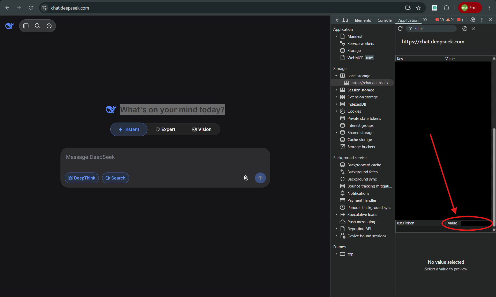

# DS Free Agent • Terminal Pro v1.0

یک رابط خط فرمان پیشرفته، سبک و کاملاً رایگان برای تعامل با مدل DeepSeek، با قابلیت‌های مدیریت فایل، سشن‌های مکالمه، پیوست‌کردن فایل‌ها، و ذخیره‌سازی هوشمند کد.


---

## ✨ ویژگی‌ها

- **چت با DeepSeek AI** – مکالمه با مدل پیشرفته DeepSeek با پشتیبانی از حالت تفکر (`thinking`) و جستجوی وب (`web search`).
- **کاملاً رایگان** – بدون نیاز به پرداخت، فقط کافیست توکن DeepSeek خود را وارد کنید.
- **مدیریت سشن‌ها** – ایجاد، بارگذاری، حذف و لیست کردن سشن‌های مکالمه با ذخیره‌سازی در SQLite.
- **سیستم فایل یکپارچه** – دستورات کامل برای مدیریت فایل‌ها و پوشه‌ها (`/ls`, `/cd`, `/mkdir`, `/rm`, `/mv`, `/cp`, `/touch`, `/edit`, `/cat`, `/run`, ...).
- **پیوست فایل به AI** – با دستور `/attach` یا دکمه 📎، فایل‌ها را به متن سوال ضمیمه کنید.
- **ذخیره‌سازی هوشمند کد** – کدهای موجود در پاسخ‌ها (با فرمت ` ```lang `) به‌صورت خودکار ذخیره می‌شوند.  
  - نام فایل از کامنت‌های داخل کد استخراج می‌شود (مثل `<!-- index.html -->` یا `// script.js`).  
  - اسکریپت‌های `bash`/`shell`/`cmd` فقط **نمایش** داده می‌شوند و **ذخیره نمی‌شوند**.
- **رفکتور کد با AI** – با دستور `/refactor <file>` کد را بهینه‌سازی کنید.
- **رابط کاربری زیبا** – تم رنگی یکپارچه (Tokyo-Night Inspired)، فونت‌های حرفه‌ای، پشتیبانی از RTL و نمایش صحیح فارسی/عربی.
- **تاریخچه دستورات** – با کلیدهای بالا/پایین، دستورات قبلی را مرور کنید.
- **نمایش اسکریپت‌های شل** – اسکریپت‌های Bash/Shell/Cmd فقط نمایش داده می‌شوند (بدون ذخیره‌سازی خودکار).


---

### پیش‌نیازها
- Python 3.8 یا بالاتر
- توکن معتبر DeepSeek

<div align="center">
  

  
*برای دریافت توکن، به [platform.deepseek.com](https://platform.deepseek.com) بروید و توکن خود را بسازید.*

</div>
### مراحل نصب

1. **کلون کردن مخزن:**
```bash
git clone https://github.com/yourusername/ds-free-agent.git
cd ds-free-agent
```

2. **نصب وابستگی‌ها:**
```bash
pip install -r requirements.txt
```

3. **تنظیم توکن:**
فایل `ds_free_agent.py` را باز کرده و توکن خود را در متغیر `TOKEN` قرار دهید:
```python
TOKEN = "your-deepseek-api-token-here"
```

4. **اجرا:**
```bash
python ds_free_agent.py
```

---

## 📋 دستورات کامل

### مدیریت سشن
| دستور | توضیح |
|-------|-------|
| `/new [عنوان]` | ساخت سشن جدید |
| `/sessions` | لیست سشن‌ها |
| `/load <id>` | بارگذاری سشن با ID |
| `/delete <id>` | حذف سشن |

### مدیریت فایل
| دستور | توضیح |
|-------|-------|
| `/ls [path]` | لیست فایل‌ها و پوشه‌ها |
| `/tree [path]` | نمایش ساختار درختی |
| `/search <keyword>` | جستجو در فایل‌های متنی |
| `/cat <file>` | نمایش محتوای فایل |
| `/edit <file>` | ویرایش فایل (ویرایشگر داخلی) |
| `/write <file>` | نوشتن فایل جدید (ورودی چندخطی) |
| `/run <file.py>` | اجرای فایل پایتون |
| `/refactor <file>` | بهینه‌سازی کد با AI |
| `/cd <path>` | تغییر مسیر |
| `/pwd` | نمایش مسیر فعلی |
| `/mkdir <name>` | ساخت پوشه جدید |
| `/rm <file/dir>` | حذف فایل یا پوشه |
| `/mv <src> <dst>` | جابجایی یا تغییر نام |
| `/cp <src> <dst>` | کپی فایل یا پوشه |
| `/touch <file>` | ساخت فایل خالی |

### پیوست فایل به AI
| دستور | توضیح |
|-------|-------|
| `/attach <file>` | پیوست فایل به مکالمه |
| `/detach <file>` | حذف فایل از پیوست‌ها |
| `/clearattach` | پاک کردن همه پیوست‌ها |
| `/context` | بارگذاری همه فایل‌های متنی به context |

### سایر دستورات
| دستور | توضیح |
|-------|-------|
| `/help` | نمایش راهنما |
| `/clear` | پاک کردن صفحه ترمینال |
| `/openfolder` | انتخاب پوشه با دایالوگ |
| `/exit` یا `/quit` | خروج از برنامه |

---

## 🎨 کلیدهای میانبر

| کلید | عملکرد |
|------|--------|
| `Enter` | ارسال پیام/دستور |
| `↑` / `↓` | مرور تاریخچه دستورات |
| `Ctrl+L` | پاک کردن صفحه |
| `Ctrl+C` | پاک کردن خط ورودی |
| `Esc` | خروج از برنامه |

---

## 🧠 قابلیت‌های ویژه

### ذخیره‌سازی هوشمند کد
وقتی AI کدی در پاسخ خود ارائه می‌دهد (با فرمت ` ```lang `)، برنامه به‌صورت خودکار:

1. نام فایل را از کامنت‌های داخل کد استخراج می‌کند (مثلاً `<!-- style.css -->` یا `// main.js`)
2. اگر نامی پیدا نشد، از نام زبان و یک شمارنده استفاده می‌کند (مثلاً `python_1.py`)
3. از بازنویسی فایل‌های موجود جلوگیری می‌کند (افزودن شماره به انتهای نام)
4. اسکریپت‌های `bash`/`shell`/`cmd` را **ذخیره نمی‌کند** و فقط نمایش می‌دهد

### پشتیبانی از RTL
نمایش صحیح متون فارسی و عربی با استفاده از کتابخانه‌های `arabic_reshaper` و `python-bidi`.

---

## 🛠️ ساختار پروژه

```
ds-free-agent/
├── ds_free_agent.py      # فایل اصلی برنامه
├── requirements.txt      # وابستگی‌ها
├── README.md            # این فایل
├── LICENSE              # مجوز (MIT)
└── deepseek.db          # دیتابیس SQLite (ساخته می‌شود)
```

---

## 📦 وابستگی‌ها

- `customtkinter` – رابط کاربری مدرن
- `arabic_reshaper` – بازسازی حروف فارسی/عربی
- `python-bidi` – نمایش صحیح متن‌های RTL

**توجه:** بقیه کتابخانه‌ها (`tkinter`, `sqlite3`, `os`, ...) جزو کتابخانه‌های استاندارد پایتون هستند.

---

## 🔧 عیب‌یابی

### خطای `TclError` در سایدبار
این خطا در نسخه پایدار رفع شده است. اگر همچنان مشاهده کردید، لطفاً Issue ثبت کنید.

### خطای `ModuleNotFoundError: No module named 'DeepSeek'`
ماژول `DeepSeek.api` بخشی از این پروژه نیست. باید آن را از منبع رسمی DeepSeek دریافت کرده و در مسیر مناسب قرار دهید.

### خطا در نمایش فارسی/عربی
کتابخانه‌های `arabic_reshaper` و `python-bidi` را نصب کنید:
```bash
pip install arabic_reshaper python-bidi
```

---

## 🤝 مشارکت

مشارکت‌ها بسیار خوش‌آمد هستند! لطفاً:

1. مخزن را Fork کنید
2. تغییرات خود را اعمال کنید
3. یک Pull Request ارسال کنید

---

## 📜 مجوز

این پروژه تحت مجوز **MIT** منتشر شده است. برای اطلاعات بیشتر فایل `LICENSE` را ببینید.

---

## 👨‍💻 توسعه‌دهنده

ساخته شده با ❤️ توسط تیم DS Free Agent

---

## ⭐ حمایت

اگر این پروژه برای شما مفید بود، لطفاً یک ⭐ به مخزن بدهید و آن را با دیگران به اشتراک بگذارید!

---

**نسخه:** 1.0  
**آخرین به‌روزرسانی:** مرداد ۱۴۰۴
```
